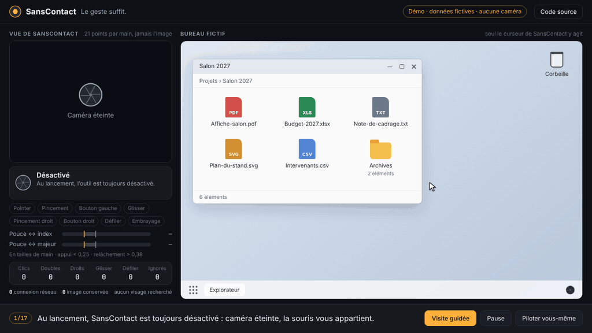
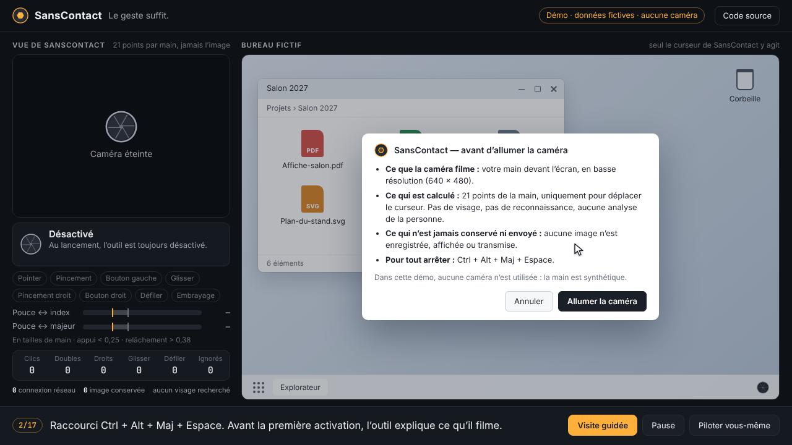
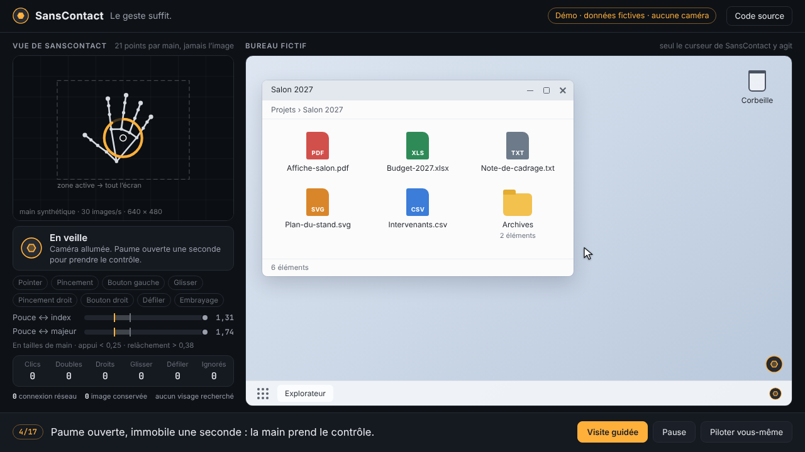
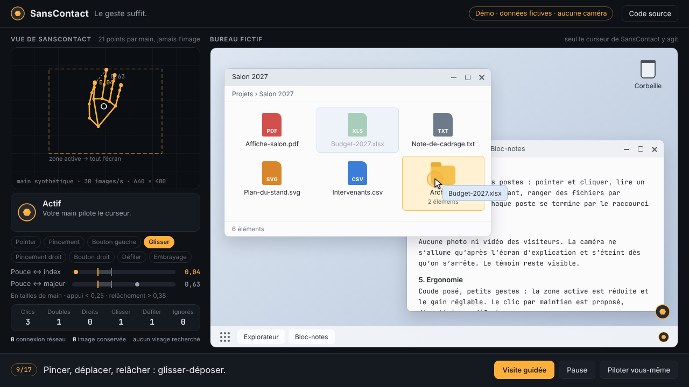
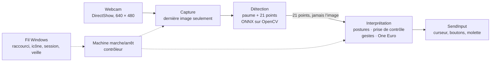

# SansContact

> **Le geste suffit.** Piloter Windows avec la main, devant une simple webcam. Tout reste sur le PC.

**English summary.** SansContact is a Windows prototype that moves the mouse pointer with hand gestures in front
of an ordinary webcam, private by design: 100 % local, no network, no stored image, camera released as soon as
it is not needed. Hand landmarks come from the MediaPipe hand models in ONNX form, run by OpenCV with our own
pre- and post-processing (MediaPipe itself is not used: its native library embeds usage telemetry). An explicit
gesture state machine turns 21 points into clicks, double clicks, drag and drop, scrolling and a clutch. Try the
**[interactive demo](#démo-interactive)**: no camera, a synthetic hand drives a fictitious desktop through a
JavaScript port of the real engine, checked frame by frame against the Python code. Work in progress
(phases 1 and 2 of 7 done).



| Écran d’accord | Prise de contrôle | Glisser-déposer |
|---|---|---|
|  |  |  |

*Captures de la démo en ligne : main synthétique, bureau et fichiers fictifs, aucune caméra.*

---

## Démo interactive

**[https://atangui.github.io/sans-contact/](https://atangui.github.io/sans-contact/)**

La page tourne entièrement dans le navigateur, sans caméra et sans serveur. À gauche, ce que « voit »
SansContact : 21 points par main, jamais une image. À droite, un bureau fictif qui ne reçoit que ce que
l’application enverrait à Windows (déplacements, boutons, molette).

- **Visite guidée** (environ 50 s) : activation et écran d’accord, prise de contrôle paume ouverte, clic,
  double clic, défilement, glisser-déposer, clic droit, embrayage, une autre main ignorée, pause par la souris
  physique, main sortie du champ, arrêt.
- **Piloter vous-même** : votre souris, sur la vue caméra, joue la main. Maintenez `O` (paume ouverte) une
  seconde pour prendre le contrôle, puis clic gauche maintenu pour pincer pouce + index, clic droit pour
  pouce + majeur, `D` pour deux doigts (défiler), `F` pour le poing. Sur téléphone, des boutons remplacent
  les touches. Le clic par maintien et le mode relatif s’essaient aussi.

**Ce qui est réel :** le moteur de la démo (`docs/demo/engine.js`) est une traduction ligne à ligne du code
Python (postures, machine à états des gestes, prise de contrôle, filtre One Euro, curseur, verrouillage sur la
main engagée, clic par maintien, machine marche/arrêt, main synthétique des tests). `tests/test_demo_engine.py`
fait tourner les deux versions sur les mêmes images et compare chaque résultat, image par image, à 10⁻⁹ près.

**Ce qui ne l’est pas :** la détection de la main dans une vraie image (modèles ONNX sur OpenCV), la partie
Windows (raccourci global, icône de notification, fenêtres administrateur, mise en veille) et les temps de
calcul réels, mesurés dans [docs/MESURES.md](docs/MESURES.md).

La page elle-même ne fait aucune requête après son chargement : politique de sécurité `default-src 'none'`,
scripts et styles du même site, polices du système, aucun CDN. Un témoin compte les tentatives de connexion et
les affiche (0).

## Le problème

La souris sollicite toujours le même poignet, et il y a des moments où l’on ne peut pas la toucher : plâtre ou
douleur, mains occupées ou sales en atelier, environnement stérile, présentation debout devant un écran.
Une webcam suffit pour suivre une main. Mais une caméra filme une personne : pour qu’un tel outil soit
acceptable au bureau, la protection de la vie privée doit être la règle de construction, pas une option.

SansContact part de là. L’image ne quitte jamais la mémoire vive et ne sert qu’à placer un curseur ; rien n’est
envoyé, rien n’est conservé, et la personne garde la main à tout moment (raccourci, souris physique).

## Fonctionnalités

**Marche / arrêt (phase 1)**

- Quatre états explicites : *Désactivé*, *En veille*, *Actif*, *En pause*. Toujours désactivé au lancement,
  pas de démarrage automatique avec Windows par défaut.
- Raccourci global `Ctrl + Alt + Maj + Espace` (`RegisterHotKey`, aucun hook clavier ni souris), icône de
  notification, témoin « caméra allumée » en forme d’iris toujours visible.
- Prise de contrôle par la paume ouverte, immobile une seconde ; ensuite seule cette main pilote, toute autre
  main est ignorée et ses données jetées aussitôt.
- Image en miroir, zone active réduite projetée sur tout le bureau (tous les écrans), filtre One Euro,
  injection `SendInput`.
- La souris physique est prioritaire : si le curseur n’est pas où SansContact l’a mis, pause immédiate.
  Fenêtres administrateur (UIPI) et écran sécurisé détectés, sans jamais proposer de droits administrateur.

**Gestes (phase 2)**

| Geste | Posture | Effet |
|---|---|---|
| Prendre le contrôle | Paume ouverte, immobile 1 s | L’outil passe en « Actif » |
| Pointer | Main détendue | Le centre de la paume déplace le curseur |
| Clic gauche | Pincer pouce + index | Curseur figé et ramené là où l’on visait |
| Double clic | Deux pincements rapides | Curseur gelé pendant le délai de double clic de Windows |
| Glisser-déposer | Pincer, déplacer, relâcher | Bouton maintenu pendant le déplacement |
| Clic droit | Pincer pouce + majeur, index écarté | Menu contextuel |
| Défiler | Index et majeur tendus | Vitesse proportionnelle à l’écart, vertical et horizontal |
| Embrayage | Poing fermé | Rien n’est cliqué, le curseur ne bouge plus |
| Clic par maintien (option) | Curseur immobile 1 s | Clic gauche, désactivé par défaut |

Toutes les distances sont divisées par la taille de la main : les gestes ne dépendent pas de la distance à la
caméra. Hystérésis (appui sous 0,25, relâchement au-dessus de 0,38), durées minimales, le poing l’emporte
toujours sur un pincement, aucun bouton ne reste enfoncé (main perdue, pause, arrêt, erreur). L’analyse de
cohérence et les réglages sont dans [docs/GESTES.md](docs/GESTES.md) ; deux minutes simulées de « parler avec
les mains » ne produisent aucun clic.

## Vie privée par conception

- **100 % local.** Un coupe-réseau est installé avant tout autre import et compte les tentatives (0) ; un
  témoin lit en plus les tables de connexions de Windows pour le processus, car le code natif peut contourner
  Python. Aucun serveur, aucun port, même local.
- **Pas de MediaPipe.** Sa bibliothèque native embarque un module de statistiques d’usage capable d’envoyer des
  données sur Internet : les modèles de la main (ONNX, Apache-2.0) tournent sur OpenCV avec un traitement écrit pour le
  projet, et un test échoue si MediaPipe revient. Détails : [docs/DECISIONS.md](docs/DECISIONS.md) (D4, D5).
- **Aucune image conservée.** Traitement en mémoire, tampons écrasés, rien sur disque, rien dans les journaux
  ni dans les rapports d’erreur. Le retour visuel est un squelette dessiné à partir des coordonnées.
- **Caméra allumée le moins possible.** Seulement quand l’outil est activé ; libérée après 30 s de pause, au
  verrouillage, à la mise en veille, écran éteint, au changement d’utilisateur, en cas d’erreur. Caméras
  infrarouges (Windows Hello) exclues.
- **Transparence.** Écran d’accord avant le premier allumage ; journal technique sans date ni heure, sans
  position du curseur ni titre de fenêtre ; « Supprimer toutes mes données » efface tout.
- **Dépôt protégé.** Un contrôle avant chaque commit (et en intégration continue, sur tout l’historique)
  refuse toute image ou vidéo hors des captures de la démo, tout chemin local, lien privé ou adresse e-mail
  personnelle.

Pour une lecture non technique : [docs/CONFIDENTIALITE.md](docs/CONFIDENTIALITE.md).

## Architecture



| Dossier | Rôle |
| --- | --- |
| `src/sanscontact/capture/` | Choix de la caméra par son nom (infrarouge exclue), lecture, échange de la dernière image entre fils. |
| `src/sanscontact/perception/` | Modèles de la main (ONNX) exécutés par OpenCV : détection de paume, recadrage, 21 points, suivi. |
| `src/sanscontact/interpretation/` | Postures, prise de contrôle, verrouillage sur une main, machine à états des gestes, filtre One Euro, curseur. |
| `src/sanscontact/output/` | `SendInput`, écrans et DPI, fenêtres administrateur (UIPI). |
| `src/sanscontact/power.py` | Machine marche/arrêt, seule source de vérité de l’application. |
| `src/sanscontact/privacy/` | Coupe-réseau, témoin des connexions, journal sans date. |
| `src/sanscontact/ui/` | Icône de notification, témoin iris dessiné par le code, boîtes de dialogue. |
| `docs/` | Documentation et démo en ligne (`index.html`, `demo/`, `assets/demo/`). |
| `scripts/` | Modèles (téléchargement vérifié), diagnostics chiffrés, contrôle de confidentialité, captures de la démo. |
| `tests/` | Tests sur mains synthétiques, jamais d’enregistrement d’une vraie personne. |

## Mesures

Sur un portable Intel Core Ultra 7, webcam intégrée, 4 fils de calcul OpenCV (le cas le plus lent : aucune
main visible, la paume est recherchée à chaque image) :

| Mesure | Valeur |
|---|---|
| Images traitées | 29,4 à 29,8 par seconde |
| Image lue → 21 points | 10,9 ms en moyenne, 11,6 ms au 95ᵉ centile |
| Processeur (tous cœurs) | 7,9 % |
| Connexions réseau | 0 |

Détails, méthode et limites : [docs/MESURES.md](docs/MESURES.md). Le banc complet (cibles de Fitts,
tremblement, faux clics) arrive en phase 4.

## Lancer (développement)

Prérequis : Windows 10 ou 11, Python 3.14, sans droits administrateur.

```bat
py -3.14 -m venv .venv
.venv\Scripts\python.exe -m pip install --require-hashes --no-deps -r requirements.txt -r requirements-dev.txt
.venv\Scripts\python.exe scripts\fetch_models.py
.venv\Scripts\python.exe scripts\install_hooks.py
SansContact.cmd
```

Tests : `.venv\Scripts\python.exe -m pytest` (aucune caméra nécessaire, points synthétiques uniquement ; plus
de 380 tests). Les tests de la démo demandent Node.js et sont ignorés sans lui. Analyse du code :
`ruff check .` ; contrôle de confidentialité : `scripts\privacy_check.py --all-files` puis `--history`.
L’intégration continue (GitHub Actions, Windows) lance les trois.

Les réglages vivent dans `%LOCALAPPDATA%\SansContact\settings.json` ; `config.example.json` en montre la liste
avec un exemple de valeurs.

## Démo en ligne (GitHub Pages)

La démo est le dossier `docs/` : `index.html`, les scripts de `docs/demo/` (sans dépendance ni étape de
construction) et les captures de `docs/assets/demo/`. Elle s’ouvre aussi directement depuis le disque, sans
serveur.

- **Publier :** Settings › Pages › *Deploy from a branch*, la branche publiée, dossier `/docs`.
- **Garder le moteur à jour :** toute modification de `src/sanscontact/interpretation/` doit être reportée dans
  `docs/demo/engine.js` ; `tests/test_demo_engine.py` échoue sinon.
- **Refaire les captures :** `node scripts/capture_demo.js` (Node.js, Playwright avec Chromium et ffmpeg,
  outils de développement non installés par le projet). La page tourne sur une horloge simulée : chaque capture
  montre exactement le même déroulement, et les images intermédiaires sont écrites hors du dépôt puis
  supprimées.

## Feuille de route

| Phase | Contenu | État |
|---|---|---|
| 1 | Socle : caméra, détection de la main, curseur, marche/arrêt, garde-fous de vie privée | Fait |
| 2 | Gestes : clics, double clic, glisser-déposer, défilement, embrayage | Fait |
| 3 | Interface : écran d’accord en trois étapes, pastille d’état, réglages, polices embarquées | À venir |
| 4 | Mesures : cibles de Fitts, tremblement, faux clics, compatibilité par application | À venir |
| 5 | Mode tête | À venir |
| 6 | Mode regard | À venir |
| 7 | Publication : README complet, captures, démo | Démo et captures avancées |

## Structure du dépôt

```
sans-contact/
├── src/sanscontact/        application (Python 3.14, Windows)
├── tests/                  tests sur mains synthétiques ; tests/js : banc de la démo
├── docs/                   documentation + démo en ligne (index.html, demo/, assets/demo/)
├── scripts/                modèles, diagnostics, contrôle de confidentialité, captures
├── models/                 modèles ONNX téléchargés et vérifiés (non versionnés)
├── SansContact.cmd         lanceur Windows (sans console, jamais en administrateur)
├── config.example.json     liste des réglages (valeurs par défaut)
└── LICENSE                 MIT
```

## Crédits

Conçu et développé par Charles Atangui. Licence [MIT](LICENSE). Modèles de la main : conversions ONNX des
modèles MediaPipe publiées par OpenCV Zoo (Apache-2.0), voir [THIRD_PARTY_LICENSES.md](THIRD_PARTY_LICENSES.md).
Sécurité : [SECURITY.md](SECURITY.md). Tous les noms, fichiers et documents de la démo sont fictifs.
