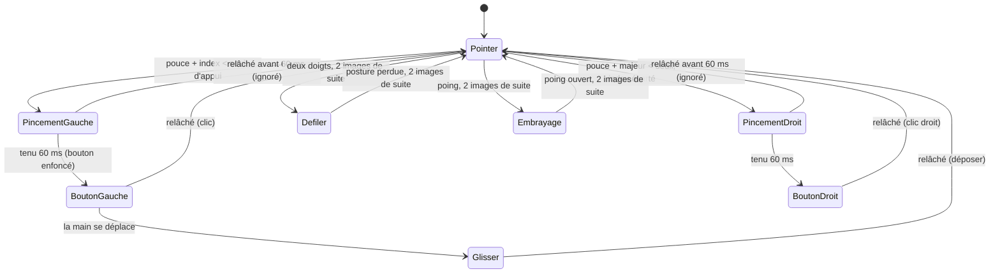

# Gestes

Mode main. Toutes les distances sont divisées par la taille de la main (du poignet à la base du majeur) :
les gestes ne dépendent pas de la distance à la caméra.

## Les gestes

| Geste | Posture | Effet | Curseur |
|---|---|---|---|
| Prendre le contrôle | Paume ouverte, doigts écartés, immobile 1 s (en veille ou en pause) | L'outil passe en « Actif » | — |
| Pointer | N'importe quelle posture détendue | Le centre de la paume déplace le curseur (image en miroir) | Suit la main |
| Clic gauche | Pincer pouce + index, puis relâcher | Bouton gauche enfoncé puis relâché | Figé dès le début du pincement |
| Double clic | Deux pincements rapides | Deux clics que Windows reconnaît comme un double clic | Figé entre les deux |
| Glisser-déposer | Pincer pouce + index, garder, déplacer la main, relâcher | Bouton gauche maintenu pendant le déplacement | Suit la main |
| Clic droit | Pincer pouce + majeur, index écarté | Bouton droit enfoncé puis relâché | Figé |
| Défiler | Index et majeur tendus, annulaire et auriculaire repliés, pouce écarté ; déplacer la main | Molette verticale et horizontale, vitesse proportionnelle à l'écart avec la position de départ | Figé |
| Embrayage | Poing fermé | Rien n'est cliqué | Figé (en mode relatif : on peut replacer la main, comme on soulève une souris) |
| Clic par maintien (option, désactivé) | Garder le curseur immobile 1 s | Clic gauche | — |

Sortir la main du champ : au bout de 0,25 s tout bouton enfoncé est relâché ; au bout de 3 s l'outil
repasse en veille.

## Machine à états

Le code est dans `src/sanscontact/interpretation/gestures.py` ; la fonction `intent()` contient à elle seule
toutes les règles de cohérence ci-dessous.

## Réglages par défaut (modifiables)

| Réglage | Valeur | Rôle |
|---|---|---|
| `pinch_press` | 0,25 | Seuil d'appui : le pincement commence en dessous |
| `pinch_release` | 0,38 | Seuil de relâchement : il finit au-dessus. Entre les deux, la bande d'hystérésis : rien ne change |
| `min_press_ms` | 60 ms | Durée minimale d'un pincement ; plus court, il est ignoré |
| `click_rollback_ms` | 100 ms | Au début d'un pincement, le curseur revient où il était 100 ms plus tôt |
| `drag_start` | 0,35 | Déplacement de la paume (en tailles de main) qui transforme un clic en glisser |
| Double clic | Délai de Windows (500 ms ici), lu et jamais modifié | Durée pendant laquelle le curseur reste figé après un clic |
| `scroll_dead_zone` | 0,10 | Zone morte du défilement |
| `scroll_speed` | 12 crans/s par taille de main | Vitesse du défilement |
| `scroll_mode` | `smooth` | Petits pas (défilement fluide) ; `notches` envoie des crans entiers (`WHEEL_DELTA` = 120) pour les applications qui les exigent |
| `pointer_mode` | `absolute` | `relative` : la main déplace le curseur, avec accélération |
| `dwell_click` | désactivé | Clic par maintien |

## Analyse de cohérence

Objectif : aucun geste ne peut être confondu avec la posture de pointage ni avec un autre geste.
Un faux clic peut envoyer un mail ou supprimer un fichier.

| Confusion possible | Pourquoi elle n'arrive pas |
|---|---|
| Pointer → clic | En pointant, le pouce reste loin des bouts des doigts (> 1 taille de main sur les postures types). Il faut descendre sous 0,25 **et** y rester 60 ms. |
| Pincement hésitant → clic | Tant que la distance reste entre 0,25 et 0,38 (hystérésis), rien ne se déclenche ; les pincements trop brefs sont ignorés (compteur « ignoré »). |
| Clic gauche ↔ clic droit | Gauche : pouce-index sous le seuil **et** pouce-majeur au-dessus. Droit : pouce-majeur sous le seuil **et** index franchement écarté (au-dessus du seuil de relâchement). Un pincement à trois doigts ne déclenche rien. |
| Poing → clic | Dans un poing, le pouce repose près des doigts. Le poing est reconnu en premier (les quatre bouts de doigts près de la paume) et l'emporte toujours. Un pincement exige aussi que le doigt pincé ne soit pas replié. |
| Défilement ↔ pincement | Le défilement exige le pouce écarté des deux doigts tendus. |
| Défilement ↔ pointer avec l'index | Pointer du doigt (seul l'index tendu) n'est pas la posture à deux doigts. |
| Paume ouverte (engagement) ↔ défilement | La paume ouverte a les cinq doigts tendus et écartés ; le défilement exige annulaire et auriculaire repliés. En mode actif, la paume ouverte est simplement du pointage. |
| Clic ↔ glisser | Le glisser n'apparaît que si la paume se déplace de plus de 0,35 taille de main pendant le pincement ; sinon c'est un clic, au point visé. |

Vérifié automatiquement (`tests/test_gesture_coherence.py`, `tests/test_gestures.py`) sur des mains
synthétiques : chaque posture à 3 tailles, 3 inclinaisons, les deux mains et deux formats d'image ne
déclenche que son geste ; avec du bruit sur les points, au plus 2 images sur 50 s'écartent (absorbées par
les durées minimales) ; une simulation de deux minutes de « parler avec les mains » ne produit aucun clic.

**Limites :** ces vérifications portent sur un modèle de main simplifié en deux dimensions. La main réelle
(rotation vers la caméra, doigts qui se cachent, éclairage) doit être testée physiquement, et le taux de faux
clics sera mesuré en phase 4 (2 minutes de gestes naturels, objectif : zéro).

## Différences avec l'idée de départ

- Le défilement est « à vitesse » (comme une manette) : plus la main s'éloigne de sa position de départ,
  plus ça défile vite. On peut ainsi lire un long document sans ramener la main.
- En mode absolu (par défaut), l'embrayage fige le curseur ; quand le poing s'ouvre, le curseur reprend la
  position correspondant à la main. Pour « soulever la souris » et replacer la main, il faut le mode relatif.
